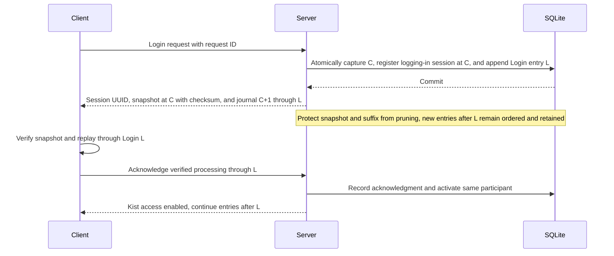
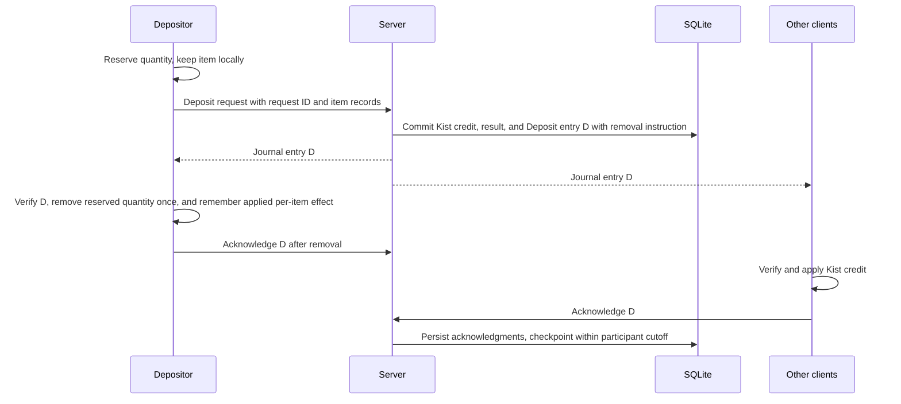
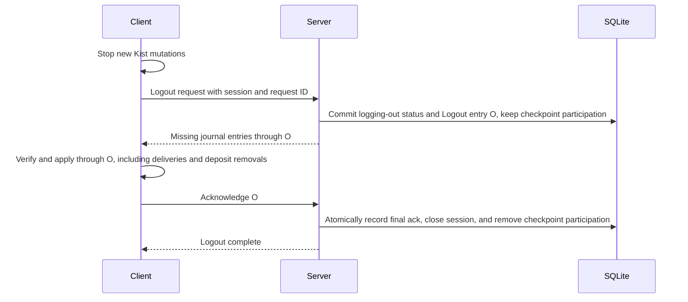
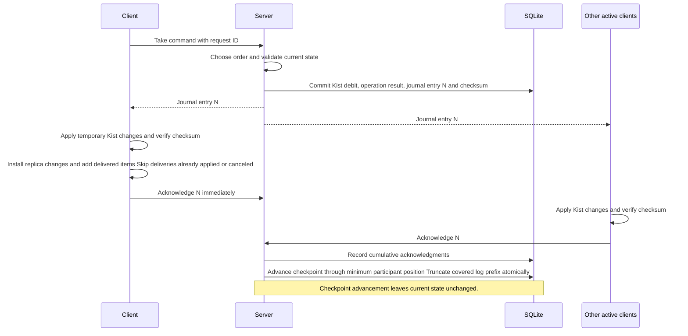
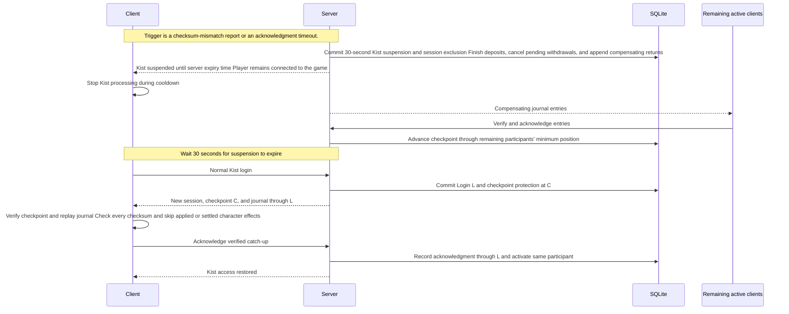

# ThorsKist network journal plan

## Active follow-up plan (2026-10-20)

[Local spending and asynchronous journal reconciliation](PLAN-LOCAL-FIRST-JOURNAL.md)
is the active plan for the post-fork design review. It supersedes conflicting
requirements below for server-authorized takes, coupled replication/effect
acknowledgments, and abandoned optimistic payments. Destination durability
remains explicitly out of scope. The implementation notes below describe the
existing system and its historical validation, not completion of the follow-up.

## M7 integrated Windows candidate (2026-10-20 UTC)

The user confirmed the v22 remote invite fix works. **v27** makes crafting and
station loading immediate, like building: cached checks permit the action and
its missing Kist cost settles asynchronously without delivering ingredients into
the pack. Station owners confirm an actual quantity/slot change before payment;
refusal, lost confirmation or failed payment can leave a free input. The old
procurement/replay queue and unused legacy craft reporting are removed.
Profiling defaults off via `[Performance] enableProfiling = false`; enabling it
and restarting restores optional F4 hooks. Both settings pass native checks.
The final targeted run passes 80 checks plus the full adapter regression suite;
real two-PC crafting/station UX remains for user QA. Both Windows installers and
the isolated host contain v27, with latest saves preserved and hashes verified.
[Implementation and native evidence](notes/performance/m7-immediate-gameplay-20261020/README.md).

The first two-PC v19 session exposed an ingress identity bug: the Steam peer's
`m_playerID` remains zero on this connection path, so valid remote Hello messages
were silently refused and the invite roster stayed empty. **v22** uses the
authenticated peer's owned character ZDO identity for both control and item
ingress, retaining exact connection/socket/ownership checks. The connecting-client
test probe now tolerates a world not yet received from the server. Nineteen
native control/identity assertions pass. Both installers and the isolated host
are updated; loaded two-PC invite/journal verification remains open.
[Diagnosis and checks](notes/validation/m7-remote-invite-20261020/README.md).

The user confirms one-click hammer building looks good. **v19** restores
withdrawal stacking lost at journal cutover, using full canonical metadata
matching and whole-delivery capacity checks. Reserved stacks are protected;
incompatible metadata stays separate. Both Windows installers and the isolated
install are updated after the user closed the game. The separate-copy native
probe passes 49 checks, including 18 stacking checks. Loaded-world stacking QA
remains open. [Stacking rationale and evidence](notes/network-journal-m7.md#withdrawal-stacking-v19-2026-10-20-utc).

At the user's explicit request, **v16** makes hammer placement immediate and
optimistic: successful vanilla placement queues only missing Kist materials,
which settle without adding inventory items. A second click is no longer needed.
Pending costs reduce cached spendable stock. Exceptional world/payment races
retain the piece, per the user's accepted tradeoff. Crafting/stations keep their
existing procurement behavior. Both installers and the isolated install are
updated; the separate-copy native probe passes 31 checks. Loaded-world hammer
QA and cold main-thread budget remain open.
[Hammer behavior and validation](notes/network-journal-m7.md#immediate-hammer-placement-v16-2026-10-20-utc).

The user's v15 loaded-world capture completes 45 resin transfers with no queue
overflow or cooldown. Traced main-thread work peaks at 0.421 ms; command reply
mean is 22.1 ms, while click-to-item mean remains 74.2 ms due to delivery polling.
The original resin batch is accounted for, plus one separately journaled later
deposit. [Capture report](notes/network-journal-m7.md#loaded-world-v15-performance-capture-2026-10-20-utc).

**v15** replaces full-vault live commits with transactional row deltas and a
constant-size durable revision check. The replace-capable snapshot helper is
removed; new-vault creation cannot overwrite existing identities. Production
SQLite access is server-only; clients use the journal protocol. Automatic scratch
database fixtures are disabled in normal manual sessions. The 2,000-stack SQL
row-audit tests, 175,321 harness assertions/45 crash cases and separate-copy native
restart probe pass. Both Windows installers and isolated installation are updated.
See [the database ownership audit and measurements](notes/network-journal-m7.md#incremental-storage-and-database-ownership-audit-2026-10-20-utc).

The partial v13 resin capture identified a delivery backlog that filled the
client application queue and triggered cooldown. Conservation is verified:
281 resin in SQLite + 450 on the saved character = 731. The **v14** candidate
uses one unacknowledged batch per peer and skips unchanged timer/checkpoint
writes. Both Windows installers and the isolated installation are updated;
175,308 harness assertions and the separate-copy native probe pass. Loaded-world
burst confirmation remains open. See [the cooldown analysis](notes/network-journal-m7.md#cooldown-capture-and-bounded-delivery-fix-2026-10-20-utc).

Transfer instrumentation is installed in the matching **v13 Windows Setup/Update
bundle** and isolated game. F4 exports bounded request/sequence-correlated queue,
SQLite, verification, main-thread inventory and acknowledgment timings alongside
the preserved profiler. Drawing is excluded from this investigation. The native
probe records zero worker-thread violations, but first-use inventory work exceeds
1 ms; the target remains unproven. Repeated full-state commits and serial ack
waits are measured bottlenecks. See [the M7 instrumentation evidence](notes/network-journal-m7.md#transfer-instrumentation-2026-10-20-utc).

Preservation commits: `be429dd` (profiling baseline) and `6137246` (all existing
M7 work). Normal world startup now installs the production SQLite catalog/runtime,
authenticated direct-peer transport, listen-host sessions, bounded Unity effects,
journal inventory/UI, metadata commits, crafting/station withdrawals, and logout/
exclusion/teardown. Live legacy server item methods and `.dat` loading/writing
are removed. Provider/load/commit faults close access; no fallback or dual writes.

The **current isolated M7TEST vault** (`2186005207`) was backed up and migrated
exactly once: 587 stacks, quantities, item metadata and hird headers preserved.
Windows Unity/Mono tests call ordinary deposit/take APIs against this SQLite
vault, verify native inventory effects and committed sequences, log out and
reopen with a legacy decoder that throws if called. The original stock checksum
is restored and `.dat` stays byte-for-byte unchanged. This is automated native
API evidence with a disposable inventory, not a loaded-character/remote-peer pass.

**M7 remains open for loaded-world activation and QA.** Normal host startup,
real-character actions/lifecycle, actual crafting/station outcomes, authenticated
two-PC behavior and F4 comparison still need observed evidence. The user drives
gameplay in separate full installations; never load original worlds/characters or
modify the normal Steam installation. The first loaded host confirmed
`KIST AUTHORITY READY SQLite/journal; 1 hirds`. A local control-package cursor bug
blocked hird presentation; v9 fixes it with nine native regression assertions.
The hird appeared on v9, but initial stopped replica state prematurely closed
pending item login. v10 distinguishes pending login from terminal closure;
native verification reaches active login with all 587 display rows. Confirm the
corrected loaded-host item display before item QA.

The v10 loaded-host resin round trip now passes conservation: **731 out, 731
back, 731 in SQLite, zero on the saved character**. The latest F4 capture records
a **225.6112 ms maximum frame interval**, including **106.7334 ms instrumented
Kist work** on UI reopen. Transfers remain slow: full-vault persistence on item/
ack/timer changes, per-entry acknowledgment waits and duplicate Take requests
create a backend queue. Performance work remains open; see the resin capture
analysis in the M7 notes. These results do not establish remote-peer validation.

Both Windows installer modes (Setup and Update) use one checksummed Windows
payload with SQLite dependencies and the F4 profiler. The local isolated copy is
updated; the second PC's user must apply the matching updater there. See
[M7 evidence and handoff](notes/network-journal-m7.md) for the final v10 bundle,
checks and remaining gates. No release is published.

Preserved **legacy baseline**: idle mean 0.012 ms/frame; opening 486.586 ms;
transfer mean 83.938 ms, maximum 101.457 ms. It is not journal performance evidence.

Thor's Kist is a Valheim mod that provides shared item storage. A **hird** is a player group; its **Kist**, or **vault**, is the shared inventory. An **anchor** is its world location for access-distance checks. A **take** (withdrawal) moves items to a character; a **deposit** moves them back. A **stack** groups items in an inventory slot. A **station**, such as a smelter, consumes materials. The **invite list** (roster in code) lists connected players eligible for invitation.

Use one server-ordered **replication log**, also called the **journal**, for Kist changes and item deliveries. SQLite stores state, log entries, request results, and acknowledgments. Its write-ahead log (WAL) handles database crash recovery separately from our replication log. Details, terminology references, and tests are in [the companion document](notes/network-journal-design.md).

## Three server states

| State | Contents |
| --- | --- |
| Checkpoint state | A saved snapshot at sequence C, bounded by active, logging-in, and logging-out checkpoint participants. |
| Replication log (journal) | Entries C+1 through the latest sequence H, retained until included in a checkpoint. These entries are already committed to SQLite. |
| Current state | Checkpoint state with entries C+1 through H applied: the materialized current Kist, used to validate new requests. |

Thus `current state = replay(checkpoint state, replication log)`. Checkpoint advancement and deletion of the covered log prefix (log truncation) leave current state unchanged. SQLite WAL checkpoints are a separate disk-storage operation.

## Normal processing

Each item transaction applies to only one stack and carries one character effect for an exact quantity. An action needing multiple stacks, including crafting, submits separate transactions with separate request IDs, operation IDs, journal sequences, and effect identities. There is no multi-stack item transaction. SQLite transactions may atomically group journal entries for commit or session settlement; that does not combine their item identities or acknowledgments.

1. The client submits a command with a unique request ID (idempotency key). The server assigns an operation ID; retries with the same request ID return the same operation/result.
2. The single server writer chooses the processing order and validates against current state, including earlier journaled changes.
3. In one SQLite transaction, update current state, store the request result, and append an entry containing sequence number, operation ID, exact changed stack records/deletions, any character item delivery, and the resulting Kist checksum. Commit before sending. This is the transactional outbox pattern: state and the outgoing log entry are stored together.
4. Active clients apply entries in sequence to temporary replica state, verify the checksum, and install the result. Each item transaction has one journal effect identity and exact quantity; processing and duplicate suppression advance independently for each stack transaction. Only the recipient adds the delivered quantity to its character. Earlier documents called these deliveries “awards.”
5. Immediately send a processing acknowledgment. Its sequence means all entries through that sequence were verified and applied, including this client's per-item deliveries and deposit removals. This is a cumulative acknowledgment, not confirmation of a character save. Suppress duplicate processing in memory and resend acknowledgments. Do not request or await character saves.
6. Continue processing without waiting for all members. The minimum checkpoint-participant position is the checkpoint cutoff. Participants include active sessions and protected login/logout sessions as defined below. In one SQLite transaction, apply that prefix to checkpoint state, advance C, and delete the covered entries. Offline or suspended clients cannot hold back the cutoff and must log in again.

Append a **no-op heartbeat entry** every 10 seconds per vault with active clients, even during other activity. It advances sequence with an unchanged Kist checksum and requires normal verification/acknowledgment. The 30-second acknowledgment timeout detects an idle stalled client within roughly 40 seconds. A timeout indicates suspected failure, not proof of cheating or disconnection.

All client protocol state is in memory only: replica state, request IDs, reservations, last applied sequence, and applied per-item effect IDs. No client protocol files or other persistent client storage are used. Kist sessions are separate from game connections. Login after a cooldown uses the ordinary login sequence below.

## Admission and asynchronous work

Define a configurable maximum transaction depth for server mutation admission: accepted transactions queued for or executing in the single writer, plus committed item transactions awaiting the initiating client's processing acknowledgment, count toward the limit. Database commit alone does not release an item transaction's admission slot. Check existing request results first; an accepted retry returns its existing status without consuming another slot. Atomically check depth and reserve a slot before admitting a new mutation. Release an item transaction's slot exactly once when its processing acknowledgment is persisted, definitive rejection/failure is recorded, or exclusion settlement commits its deposit completion or withdrawal compensation. Mutations with no character effect release their slot on commit or definitive failure. Observer acknowledgments govern checkpoint retention separately and do not keep a completed item transaction pending. If admitting new work would exceed the maximum, return `TRANSACTION_DEPTH_EXCEEDED` without admitting the command, changing stock, allocating a journal sequence, or recording a terminal operation result. The client waits at least 100 ms asynchronously, then retries the same request ID and payload. Repeated depth errors repeat that backoff; they neither suspend the player nor reset existing acknowledgment deadlines. Acknowledgments, heartbeats, session cleanup, and compensation bypass mutation admission and must continue when the limit is reached so pending transactions can settle and release slots.

The initiating RPC may synchronously validate and admit or reject a request. All cross-client effects travel through the committed journal and asynchronous sequence acknowledgments. Never wait synchronously for another client or perform a synchronous all-client update. Database commits, encoding, checksums, checkpoint work, and network fan-out run outside the Unity game thread. Apply Unity inventory/UI changes on that thread in bounded batches, yielding between batches; never drain an unbounded journal or rebuild every client's state in an update loop. A slow client cannot block processing of other clients' admitted work or acknowledgments; new work remains subject to the pending-transaction limit. Start each active client's 30-second acknowledgment deadline when an entry is first queued for asynchronous delivery to it; retries and later entries cannot extend it.

The transport contract assumes reliable, ordered RPC delivery within a live connection. M5 records the installed-game transport audit and TCP loopback evidence; M6 supplies bounded transport foundations; M7 connects authenticated live RPCs, and M8 confirms each supported transport under disruption and reconnect. Application recovery covers disconnects and uncertain outcomes across reconnects. Add application retransmission or gap recovery only if transport validation shows it is needed.

## Login sequence

1. The client sends a login request with a unique request ID. The server authenticates it and checks membership and suspension. Each accepted login receives a server-generated session UUID, bound to player, vault, and epoch. Only one logging-in, active, or logging-out session may exist for a player/vault; a different login request while one exists returns `SESSION_EXISTS`. A retry of the same request returns the same UUID and marker. Every mutation, journal delivery, acknowledgment, and logout is bound to that UUID; closed UUIDs cannot be reused.
2. Under the single writer, one SQLite transaction captures checkpoint C, creates a logging-in session, appends a `Login` entry at L with an unchanged Kist checksum, and registers checkpoint protection at C. Commit before replying. The initial position C is a retention floor, not a claim of client verification. Retain an immutable snapshot at C and every entry after C, including entries arriving during transfer.
3. The client verifies and installs the snapshot, then replays C+1 through L, including its own login entry. It advances its journal position by acknowledging only verified, fully processed entries. Mutation requests remain disabled during catch-up.
4. When the server records an acknowledgment through L, it activates the session in the same writer order and enables requests; transactions from excluded sessions have already been settled on the server. Keep the same participant and acknowledgment position, with no removal/re-addition gap. Entries after L continue through normal ordered replication.

Appending the login entry and registering checkpoint protection must be atomic. A checkpoint ordered before login supplies the newer C; one ordered after login is bounded by that session's position. Duplicate login requests reuse the same session/marker. Login has a 30-second completion deadline from commit, unaffected by retries; mismatch or timeout uses suspension/cleanup and releases protection. Restart invalidates incomplete sessions before checkpointing or admitting new logins.

## Deposit sequence

1. The client reserves the exact item quantity in its character inventory and sends a deposit with a unique request ID. The item remains locally present, but cannot be spent, moved, dropped, or deposited again while unresolved. Keep the request identity and reserved-item description in memory only.
2. The server validates access, item records, and collective capacity in writer order. In one SQLite transaction it credits the Kist, stores the result, and appends `Deposit` entry D identifying the depositor and exact local quantity to remove. Commit before publishing; retries never credit twice.
3. The depositor processes the journal in order and verifies D's checksum. Only after seeing this committed entry does it remove the reserved local quantity, remember the per-item effect as applied, and acknowledge D. Other clients apply the Kist credit without removing character items. A separate success response or packet receipt is insufficient to authorize removal.
4. Duplicate delivery/replay must not remove the item again while its applied per-item identity is known. Explicit rejection releases the reservation without removal. A missing response is uncertain: retry/query the same request ID, with no automatic refund or second deposit. If removal fails, do not acknowledge D or later entries; stop Kist processing and use the 30-second suspension and server settlement.

The Kist credit is usable after server commit; it does not wait for the depositor's acknowledgment. During suspension, the server settles every accepted pending item transaction in favor of the Kist: finish deposits and compensate unacknowledged withdrawals. An admission rejection never credits a deposit. Finish or reject already admitted deposit work in writer order before closing the old session; reject later old-session traffic. Settled deposits retain their Kist credit and never require a future character removal or reconciliation gate. After the 30-second ban, ordinary login can restore access. Lost client state or character-save disagreement may leave duplicate items on the character; that is an accepted exception. Do not remove unrelated replacement items. No client storage is used.

## Logout sequence

1. The client stops submitting new mutations and sends a logout request with a unique request ID for its current session. Requests racing logout are ordered by the server writer.
2. In one SQLite transaction, mark the session logging-out and append a `Logout` entry at O with an unchanged Kist checksum. Reject subsequent mutations for that session. Keep its checkpoint participation at its existing acknowledgment position until logout completes.
3. Send all missing entries through O. The client verifies and applies them, including its deliveries and deposit removals, then acknowledges O. The marker follows every operation accepted for this session, so this acknowledgment covers them all.
4. Under the writer, persist the final acknowledgment, close the session, and remove its checkpoint participation atomically. Then confirm logout. Others continue processing; the closing session need not process entries after O. Further access requires ordinary login.

Duplicate logout requests reuse O and return recorded status; a lost completion reply cannot reopen the session. Logout has a 30-second completion deadline from marker commit, unaffected by retries; it cannot extend an earlier outstanding acknowledgment deadline. Timeout, mismatch, or disconnect uses exclusion: invalidate the session, compensate only unacknowledged withdrawals, finish pending deposits and retain their settled results, and release checkpoint protection atomically. An ordinary disconnect need not impose a cooldown. Logout does not request or await a character save.

## Timeouts, suspension, and compensation

If an active client leaves an entry unacknowledged for 30 seconds, impose a **30-second Kist access suspension**, called a Kist ban in the UI. Exclude it from requests and checkpoint acknowledgments. The player stays connected to Valheim. Track the oldest unacknowledged entry; later traffic cannot extend its deadline.

In one SQLite transaction, persist suspension and session invalidation, exclude the client, finish its pending deposits, cancel all its unacknowledged withdrawals, and append **compensating entries** returning their items. This is compensation, not rollback: original entries remain unchanged, and unrelated players' operations remain intact. Returns bypass capacity and may exceed 100% occupancy. Overflow stays visible, usable, checksummed, and persisted; ordinary deposits cannot create it.

Serialize acknowledgment and suspension handling: whichever commits first determines which deliveries remain pending. Ignore old-session acknowledgments and never return an operation twice. Items already added to a character are not removed, so a lost acknowledgment can cause duplication. A character crash or failed save after acknowledgment can lose items. Both remain accepted exceptions; this is not exactly-once character delivery.

Enforce suspension against authenticated player identity so reconnecting cannot bypass it. After 30 seconds, permit normal Kist login. No server kick or Valheim ban-list change occurs. Disconnect/hird departure also excludes the session and returns its pending deliveries, but need not impose a timed ban. Apply the same Kist rules to a listen host's local character.

Crafting and other shared-material consumption use the same single-stack withdrawal journal, acknowledgment, timeout, and compensation rules as ordinary takes. Effects already produced in the game are not undone; returning unacknowledged materials follows the same accepted duplication policy as any withdrawal. Existing crafting behavior can produce its effect before the server rejects or reduces material consumption. Retaining Kist stock in that case is an accepted error in favor of preserving Kist contents; this plan does not require authorization before the game effect.

## Checksum mismatch and login replay

On any checksum mismatch, discard failed temporary changes, stop Kist processing locally, and request **self-suspension** (self-ban). Do not add items or acknowledge the failed entry. The server immediately runs the same suspension/compensation handler, waits the 30-second cooldown, then permits ordinary login. There is no repair within the failed session. Retry a lost self-suspension request; the acknowledgment timeout is the fallback.

Login uses the journaled Login barrier L above: install verified checkpoint C and replay C+1 through L, checking every checksum, then continue later entries in order. Apply every required Kist change, but skip character effects already applied in memory or settled by exclusion: canceled withdrawals and completed deposits from closed sessions. Replay their Kist deltas normally, without applying old character effects. Canceled withdrawals still apply their original Kist deltas; later compensating entries return the stock. Acknowledge verified replayed entries even when their character deliveries are skipped. A mismatch during login repeats suspension, cooldown, and login.

## Normal take sequence

Successful withdrawal; character saving is independent.

## Error handling sequence

A checksum-mismatch report or acknowledgment timeout starts the same flow, including failures during login and heartbeat processing.

Any new checksum mismatch or acknowledgment timeout repeats this error flow.

## Modules and milestones

M1 implementation and current verification evidence are recorded in
[the M1 work log](notes/network-journal-m1.md). Its game/runtime completion gates
remain open. M2's library state machine and deterministic/model verification are
implemented in [the M2 work log](notes/network-journal-m2.md). M3's storage,
recovery, migration transaction and process-termination tests are implemented in
[the M3 work log](notes/network-journal-m3.md). M5 implements the real legacy-save
decoder; connecting and validating live migration belongs to M7. M4's replication/session layer and fault/crash verification
are implemented in [the M4 work log](notes/network-journal-m4.md).
[The M5 work log](notes/network-journal-m5.md) records the implemented item,
migration-decoder, dispatch and UI adapters, real Windows Unity/Mono evidence,
transport audit, and passing checks. M5 is complete for this narrowed adapter
scope. [M6: Transport foundations](notes/network-journal-m6.md) is complete for
bounded wire/transfer codecs, peer binding, independent workers/queues and
uninstalled direct-RPC hooks, with library and Windows Unity/Mono loopback evidence.
At the user's request, all unfinished live RPC coordination, persistence,
interception, crafting, lifecycle, UI and platform integration gates move to
[M7: Live journal integration](notes/network-journal-m7.md). Normal gameplay
continues using the legacy authority until M7's activation gates pass.
M7 is in progress: client/server/world lifetimes, action-specific access,
bounded transfers for 256 KiB items, SQLite catalog and session-row persistence,
reservation interception, and a UUID-based gameplay/display session are implemented.
The full harness and isolated Unity/Mono session probes pass. Normal-world owner
wiring, crafting/station integration, cutover and platform activation gates remain open.
[M8: Game validation and release](notes/network-journal-m8.md) follows M7.
Earlier milestone work logs retain their historical numbering.

Build a **state-sync library** without Unity dependencies and a **Valheim mod** adapting inventories, actions, RPCs, and UI to it. Inject clock and transport to test faults without launching the game. Test production library code, not a separate copy.

In M1, prototype deposit reservations against the real inventory adapter before fixing its interface. Establish exact stack identity and behavior under merging, splitting, partial removal, death, unexpected inventory changes, and representative mods. M5 tests real inventory identity and unexpected-change detection. In M7, complete gameplay interception so reserved quantities cannot be spent, moved, dropped or deposited again, and failures never remove replacement items.

The performance goal is an architecture that enables performance through deltas, asynchronous execution, and bounded work. Measure before choosing optimizations or numeric performance gates. Performance targets and deduplication/settlement retention policies remain open implementation decisions; retained identities must still prevent old retries from executing again.

| Milestone | Deliverables | Completion gate |
| --- | --- | --- |
| M1: Module boundaries and harness | Define single-stack item/command records and clock, storage, transport, inventory interfaces. Prototype deposit reservation identity and interception paths. Verify SQLite packaging and record performance baseline. | Library builds without game assemblies; fake clock/transport drive requests; reservation prototype informs the inventory interface; provider loads on supported platforms. |
| M2: State machine | Implement three states, ordering/deduplication, checksums, replay, checkpoints, and deposit removal identities. | Deterministic and independent model tests verify state equivalence, once-only server changes, and no repeated known character deliveries. |
| M3: SQLite recovery | Atomic state/log writes, operation results, checkpoint transactions, save migration with backup. | File-backed database and process-termination tests pass at commit/checkpoint/migration boundaries; committed server changes survive without repeating. |
| M4: Replication and sessions | Acknowledgments, 10-second heartbeats, timeout/self-suspension, overflow compensation, journaled login/logout barriers, server settlement of pending deposits, UUID sessions, pending-transaction admission backpressure, and login after cooldown. | Fault simulations cover reliable ordered connections, disconnects, uncertain outcomes, retries, races, stale sessions, and mismatch/rejoin; loss/reordering injections also exercise defensive behavior without assuming the live transport exposes packet loss. Login/logout cannot race checkpoints; deposits credit/remove once in-session; suspended clients cannot pin checkpoints or leave deposit reconciliation blocking rejoin. Duplicate logins cannot create concurrent sessions. Committed item transactions retain depth until acknowledged or settled; depth rejection requires 100 ms backoff and never mutates stock. |
| M5: Adapter foundations (complete) | Canonical item serialization, real inventory effects and reservation identity, legacy-save decoder, bounded game-thread dispatcher, pooled rows, cached counts, Windows Unity/Mono SQLite provider and reproducible isolated game probes. Record transport audit and TCP loopback evidence. | Real-game adapter/journal/decoder/UI probes and existing build/Harmony/category/package checks pass. Verified effects precede acknowledgment; failed addition is unacknowledged and compensated. Existing saves are backed up and unchanged. Completion does not enable the journal in normal gameplay or imply other-platform/multiplayer validation. |
| M6: Transport foundations (complete) | Versioned bounded wire codecs, immutable chunked transfers, connection/session binding, independent bounded workers/send queues, direct-RPC registration and lifecycle hooks. See the [M6 work log](notes/network-journal-m6.md). | Library fault tests, Windows Unity/Mono real-RPC loopback and existing build/Harmony/accessibility/category/version/package checks pass; original saves are unchanged. Completion does not install the transport owner, replace the legacy authority or establish authenticated multiplayer/platform coverage. |
| M7: Live journal integration | Complete live RPC coordination, authenticated sessions and fan-out, SQLite catalog/migration, reservation interception, single-stack crafting/station withdrawals, lifecycle/access controls, authoritative stack-ID/overflow UI and supported-platform packaging. All pending M6 work and original live-integration gates are retained in the [M7 implementation plan](notes/network-journal-m7.md). | Normal host and remote gameplay use the journal as their only item authority. Backed-up legacy import/reopen preserves all stacks and metadata. All mutation paths respect reservations and suspension; only successful effects are acknowledged. Timers, settlement, logout/rejoin and bounded game-thread work are wired. Required adapter, fault, build, Harmony, category, package and platform checks pass. |
| M8: Game validation and release | Dedicated-server/listen-host sessions with multiple clients, supported assemblies, representative mods, and baseline comparison. Confirm transport guarantees and M7 integration under network disruption and reconnect. See the [M8 validation plan](notes/network-journal-m8.md). | Last-stack races, bursts, termination, connection interruption, mismatch/rejoin, and overflow pass. Verify asynchronous replication and bounded game-thread work; report measured frame/request latency, observed stutter, and accepted client-loss/duplication cases. Numeric performance targets and optimizations follow evidence. |

## Test strategy

Test the library with deterministic scenarios, independent model-based fault simulation, and SQLite crash recovery. Test the mod with adapters, existing CI verifiers, and real multiplayer sessions. The [detailed test plan](notes/network-journal-design.md#test-plan) defines assertions and evidence. Library tests need no Valheim runtime; mod integration requires supported game assemblies/sessions. M2 through M4 library verification is recorded above, including session fault simulations and crash recovery. Real-save migration validation, mod integration and game validation remain outstanding.
